<picture>
  <source media="(prefers-color-scheme: dark)" srcset="assets/header-dark.svg">
  
</picture>

I'm a full-stack engineer with four years of shipping complete products: the screens people use, the APIs and databases behind them, the pipelines that deploy them, and lately the AI inside them. I've also led a 12-engineer team, so I care as much about code others can build on as about code that works.

### Projects

| Project | What it does | Built with |
| --- | --- | --- |
| [**Shopna**](https://shop.nextbinary.io)  live store · private code | Full e-commerce platform for a grocery and gift store in Bangladesh: customer storefront, admin dashboard and API, deployed with Docker behind Nginx. | Next.js, React, NestJS, PostgreSQL (Prisma), Docker |
| [**IELTS-AI**](https://github.com/Jubayer-cmd/IELTS-AI) | Scores IELTS essays on the 1–9 band scale with feedback on each criterion, paid per evaluation with credits. | React, FastAPI, LangGraph |
| [**Pdf-RAG-langchain**](https://github.com/Jubayer-cmd/Pdf-RAG-langchain) | Upload a PDF and ask questions about it. Answers come from vector search over the document and stream in token by token. | FastAPI, LangChain, Gemini |
| [**Star-Collector**](https://github.com/Jubayer-cmd/Star-Collector)  [play](https://star-collector-topaz.vercel.app/) | Browser arcade game: collect stars, dodge bombs, beat your best score. | Phaser, React, TypeScript |

### Contact

Open to remote Full-Stack and AI Engineer roles.

[LinkedIn](https://www.linkedin.com/in/sheikh-abu-jubayer) · [sheikhabujubayer@gmail.com](mailto:sheikhabujubayer@gmail.com)

### Bug hunt

<a href="https://jubayer-cmd.github.io/Jubayer-cmd/play/">
  <picture>
    <source media="(prefers-color-scheme: dark)" srcset="assets/bughunt-dark.svg">
    
  </picture>
</a>

Every shot is a skill. [Click to play](https://jubayer-cmd.github.io/Jubayer-cmd/play/): arrow keys and Space, or drag on a phone.
